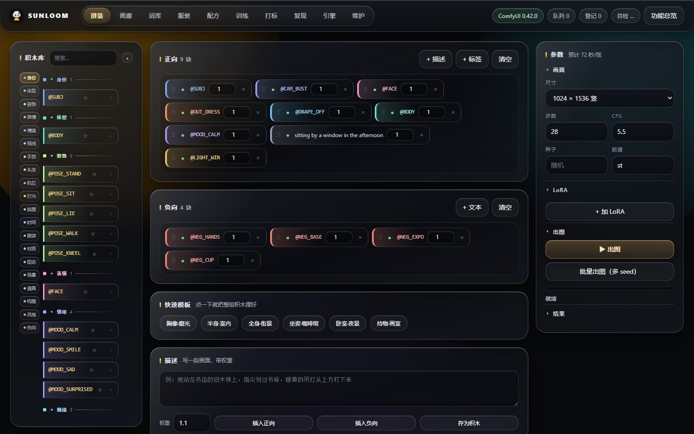
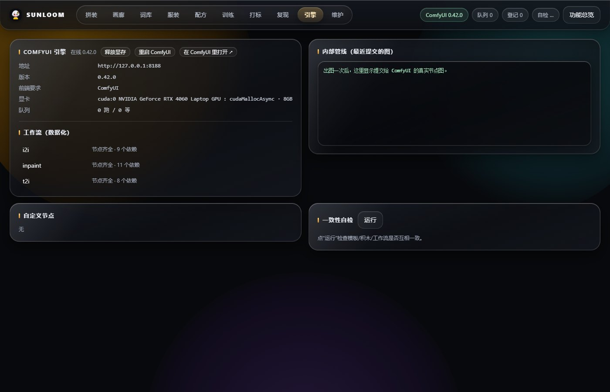

# SUNLOOM · block studio

积木式提示词工作站：在网页里拼提示词，通过 ComfyUI 出图，并自动记录每张图的配方。

- 不绑定角色 / 画风 / 模型
- 不打包 ComfyUI，也不含任何模型权重
- 纯本地：一个 FastAPI 进程 + 你自己的 ComfyUI

## 截图

拼装页（左侧积木库、中间正负向画布、右侧参数）：

引擎页（ComfyUI 状态、工作流节点检查、模型绑定）：

## 可选模块

- 打标：tools/tag_wd14.py（onnxruntime + WD14），工作站「打标」页可直接跑
- 训练：tools/train_lora.ps1（kohya sd-scripts），需在 config.json 写 kohya_dir

两个模块默认不参与出图，关掉不影响主流程。

## 它解决什么问题

扩散模型出图时，提示词往往是几十个标签的字符串，改一个词就得从头排版。
SUNLOOM 把它拆成积木：机位、光、姿势、服装、场景、道具各自一块，
可复用、可调权重、可排序，出图后还能查回当时用了哪些块。

## 快速开始

> 第一次用？先读 [docs/新手指南.md](docs/新手指南.md)。

### 0. 先准备 ComfyUI 和你的风格

本站不提供模型。你需要先有一个能跑的 ComfyUI：

- 推荐 ComfyUI 0.3.60 及以上（本仓库在 0.42.x 上验证）
- 一个 UNet / checkpoint、一个文本编码器、一个 VAE
- 先在 ComfyUI 里用默认工作流跑通一张图，确认模型和节点都正常

**默认参考**：config.example.json 是一份能直接改的配置模板；
默认参数是 1024x1536、euler、simple、28 步、CFG 5.5（对多数动漫模型比较稳）。
如果你的模型不是 UNet + 独立 CLIP 的组合（例如单文件 checkpoint），
需要把 workflows/t2i.json 的加载节点换成 CheckpointLoaderSimple。

### 1. 安装依赖

    cd sunloom-open
    python -m pip install -r requirements.txt

或运行：

    powershell -ExecutionPolicy Bypass -File install/install.ps1

安装脚本会：检查 Python 3.10+、装依赖、询问 ComfyUI 目录、
列出 ComfyUI/models 下的模型让你选，最后写 station/data/config.json。

### 2. 绑定并校验

    powershell -ExecutionPolicy Bypass -File install/bind_pipeline.ps1

它会检查：ComfyUI 是否在线、三个模型文件是否存在、必需节点是否齐全。
全部 OK 再启动。

### 3. 启动

双击仓库根目录的 start.bat（需要换端口就 start.bat 8791），它会自动找 Python、
检查依赖、打开浏览器；找不到 config.json 时会提示先跑 install.ps1。

也可以在终端里：

    powershell -ExecutionPolicy Bypass -File station/start.ps1

浏览器打开 http://127.0.0.1:8790/ ，先在「引擎」页确认 ComfyUI 在线，
然后在「拼装」页点 @SUBJ + @CAM_BUST + @OUT_CASUAL + @LIGHT_WIN，点「出图」。

## 目录

    docs/新手指南.md      10 分钟装上并出第一张图
    docs/系统介绍.md      这是什么、架构、边界
    docs/画师手册.md      怎么用积木把图做好
    docs/工作站说明.md    每个页面、每个接口
    docs/积木手册.md      全部积木与展开文本
    docs/工作原理.md      数据怎么流动

## 网络受限时怎么发布

如果 git 无法直连 github.com（TLS 被重置），但 api.github.com 可用，可以用 REST API 发布：

    set GITHUB_TOKEN=ghp_xxx
    python tools/publish_github.py --repo yourname/sunloom --message "update"

它只新增/覆盖文件，不删除远端已有文件。

### Token 安全

- 只用 fine-grained PAT，仓库选 sunloom，权限只给 Contents: Read and write；
- 设置 30-90 天过期；
- 放在环境变量 GITHUB_TOKEN 或仓库根目录的 .env（.env 已在 .gitignore）；
- 不要提交到仓库，也不要贴进聊天/截图；
- 如果 token 曾经泄露，先去 GitHub 设置里吊销。

## 发布前自检

    python tools/check_clean.py

会扫描仓库里是否混入不该发布的词（角色名、私有资产、已删除模块等）。

## 许可

MIT。模型、ComfyUI、第三方节点的许可各自遵守其原项目。

## 构图

提示词里最难写的是「怎么摆」。SUNLOOM 把摄影的构图语言做成积木：居中、三分、对称、框架、引导线、负空间、满幅、长焦/广角、高低地平线、荷兰角、剪影、倒影……共 31 块；选中后会自动检查互斥（比如居中不能和三分同时开）。